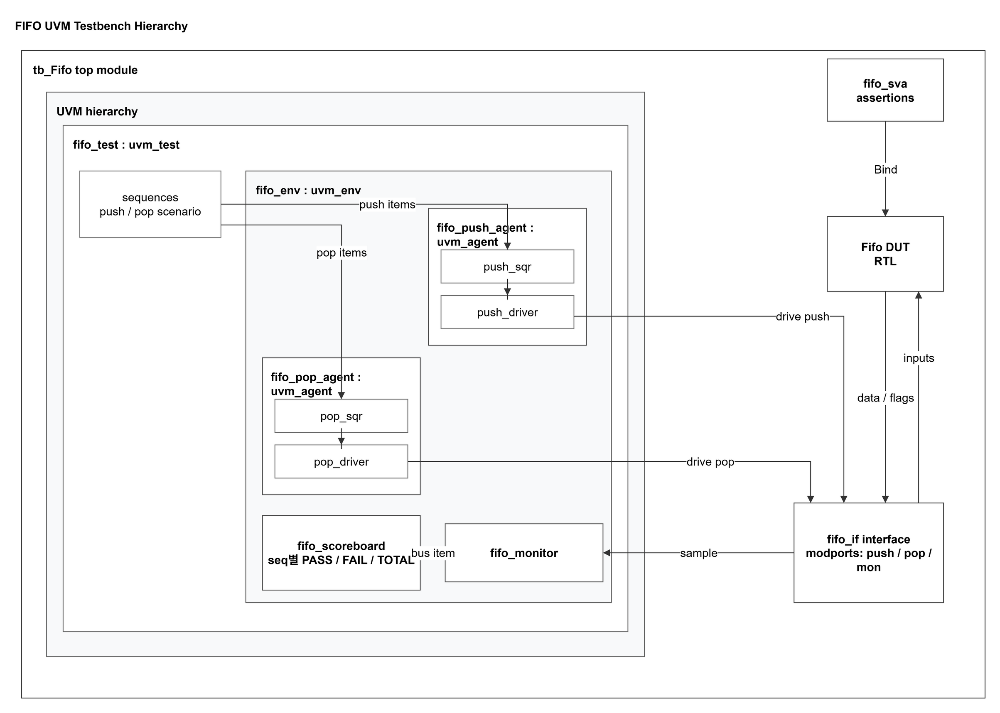
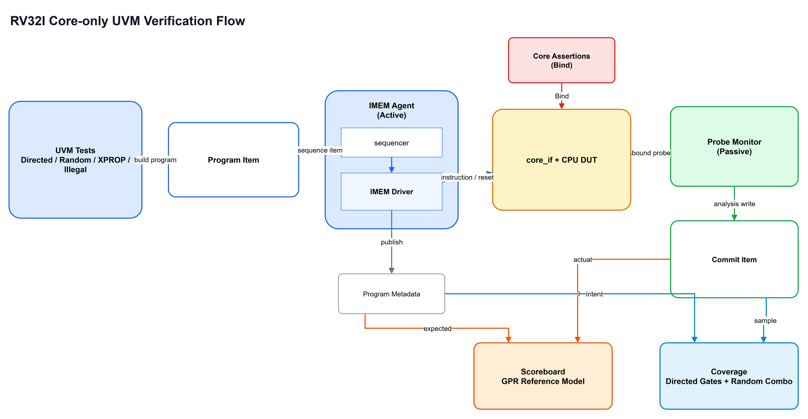
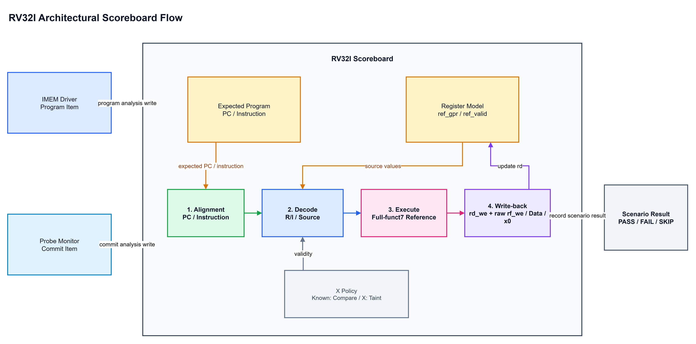

# SystemVerilog UVM & Formal Verification 프로젝트

SystemVerilog **UVM(Universal Verification Methodology)**, **DPI-C Reference Model**, **SVA(SystemVerilog Assertions)** 및 **SymbiYosys 정형검증(Formal Verification)**을 적용한 디지털 회로 검증 프로젝트 모음.

---

## 프로젝트 구성

| 폴더 | 검증 대상 (DUT) | 검증 기법 | 핵심 특징 |
| :--- | :--- | :--- | :--- |
| **[`20260905_FIFO_UVM/`](20260905_FIFO_UVM/)** | Synchronous FIFO (`Fifo.sv`) | **UVM + DPI-C + SVA Formal** | UVM 환경, C Reference Model(`fifo_c_ref_model.c`) DPI-C 연동, SymbiYosys(`Fifo.sby`, `Fifo_sva.sv`) 정형검증 |
| **[`20260911_Final/`](20260911_Final/)** | RV32I CPU Core (`rv32i_cpu.sv`) | **UVM + Bind SVA + Coverage** | R/I-Type 19개 명령어 검증, `bind` 비침습 프로브/어설션, 6개 Clean/X 시나리오 + Illegal Negative 테스트, 메타데이터 기반 Scoreboard & Functional Coverage |

---

## 1. FIFO UVM + DPI-C + SVA Formal 검증 (`20260905_FIFO_UVM/`)

- **UVM 테스트벤치 (`Testbench/`):** `tb_Fifo.sv`, `tb_Fifo_c.sv`, `tb_Fifo_simple.sv` — Sequence, Driver, Monitor, Scoreboard 구성
- **DPI-C Reference Model (`Testbench/fifo_c_ref_model.c`):** C 언어 골든 모델과 SystemVerilog UVM Scoreboard 연동 비교
- **SVA 정형검증 (`Src/Fifo_sva.sv`, `Src/Fifo.sby`):** Full/Empty 경계, 포인터 불변식, 데이터 무결성 프로퍼티를 SymbiYosys로 검증

---

## 2. RV32I Core UVM & Bind SVA 검증 (`20260911_Final/`)

### UVM 검증 환경 (`RV32I_UVM_Block_Diagram`)

### Scoreboard 흐름 (`RV32I_Scoreboard_Flow`)

- **검증 범위:** RV32I Legal R-Type 10종(`ADD`–`AND`) + I-Type 9종(`ADDI`–`SRAI`) 총 19개 ALU 명령어 및 Illegal 인코딩 Negative 검출
- **시나리오 구성 (6 Clean/X + 1 Negative):** `Sanity`, `Boundary`, `RF Access`, `Operand Profile`, `Random`, `X Propagation`, `Illegal`
- **Program Metadata 분리 (`RI_SETUP` / `RI_TARGET` / `RI_READBACK` / `RI_XPROP`):**
  - Scoreboard는 Driver 원본 명령어 기준으로 전체 명령어를 검사하되, Functional Coverage는 `RI_TARGET`만 샘플링하여 Setup 명령어에 의한 커버리지 왜곡 차단
- **비침습 Bind Probe & Assertion (`Testbench/bind/`):** `rv32i_bind.sv`, `rv32i_core_assertions.sv`, `rv32i_core_probe.sv`, `rv32i_probe_if.sv`
- **상세 기술 문서:** [`20260911_Final/Docs/RV32I_UVM_Code_Walkthrough.md`](20260911_Final/Docs/RV32I_UVM_Code_Walkthrough.md)
